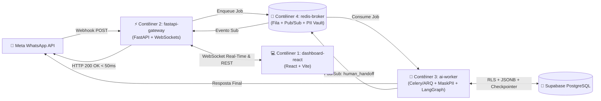
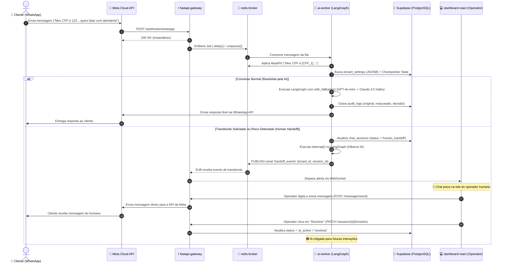

# 🌐 TAP & Blueprint Arquitetural: Migração para SaaS Global Multisetorial (AI Engine & Omnichannel)

> **Metodologia Akrium (BMAD / AIOX):** Diagnóstico → Estruturação → Acompanhamento  
> **AIOX State:** `STATE_SCOPING_AND_ARCHITECTURE`  
> **Classificação:** Documento de Arquitetura e Reaproveitamento Estratégico (ISO/IEC 42001 & LGPD/GDPR By Design)

---

## 🧭 Sumário Executivo e Diagnóstico (SPIN / SPICED)

* **Situação Atual:** O projeto **ConfirmaMed** nasceu verticalizado para o setor de saúde (clínicas, consultórios e Secretarias Municipais de Saúde), construído sobre uma stack monolítica modular em Node.js + Express + Knex.js + LangGraph.js e React.
* **Problema & Limitação de Escala:** O acoplamento semântico ao domínio médico (`pacientes`, `consultas`, `profissionais_da_saude`, `unidades_atendimento`) restringe o Endereçamento de Mercado Total (TAM). Além disso, o processamento de IA dentro do mesmo runtime Node.js da API principal compete por Event Loop sob rajadas intensas de Webhooks da Meta.
* **Implicação Comercial e Técnica:** Para escalar globalmente em múltiplos setores (Varejo, Imobiliário, Jurídico, Educação, Serviços Financeiros, Logística, Saúde e Atendimento B2B/B2C), o sistema precisa de **Abstração de Domínio Zero-Hardcode** (via JSONB dinâmico) e **Isolamento Físico de Workloads** (I/O Assíncrono vs. Processamento Cognitivo Pesado em Python).
* **Impacto Esperado (Objectives SMART):**
  * **Latência de Ingestão (Webhook ACK):** `< 50ms` no `fastapi-gateway` com enfileiramento assíncrono no Redis.
  * **Disponibilidade de IA (SLA):** `99.9%` via chaveamento automático Multi-LLM (`with_fallbacks()`).
  * **Time-to-Onboarding de Novo Setor:** `< 15 minutos` configurando apenas `tenant_settings` (JSONB) pelo Dashboard React, sem deploy de código.

---

## 💎 0. Diagnóstico de Reaproveitamento: O Que Extrair do ConfirmaMed Atual

Você já construiu no **ConfirmaMed** padrões de engenharia de altíssimo nível que 95% dos wrappers de IA no mercado não possuem. Abaixo está o mapa exato do que **reaproveitar diretamente**, o que **portar de Node.js para Python** e o que **abstrair para o modelo multisetorial**:

### 0.1. Padrões de Arquitetura & Segurança do Backend (Portar Conceito/Lógica para Python)

| Ativo Atual no ConfirmaMed | Arquivo de Origem | Como Reaproveitar na Nova Stack (`ai-worker` / `fastapi-gateway`) |
| :--- | :--- | :--- |
| **Vault de Anonimização Reversível (MaskPII com Redis TTL)** | [`PIIMasker.js`](file:///c:/projetos/confirmamed/backend/src/services/ia/security/PIIMasker.js) | **Ouro Puro.** A lógica de normalizar o JID do WhatsApp, substituir CPFs/E-mails/Documentos por tokens determinísticos (`[CPF_1]`), guardar o mapa reverso em `pii_vault:{sessionId}` no Redis com `TTL = 3600s` (Direito ao Esquecimento) e fazer `unmask()` antes de chamar tools de banco deve ser portada linha a linha para Python (`MaskPII` com `re` + ` Microsoft Presidio` ou regex customizado). |
| **Gatekeeper Determinístico (Consentimento & Interceptação Rápida)** | [`GatekeeperNode.js`](file:///c:/projetos/confirmamed/backend/src/services/ia/nodes/GatekeeperNode.js) | **Altíssimo Valor FinOps.** Antes de gastar tokens de LLM, o nó inicial verifica consentimento LGPD/GDPR e intercepta respostas curtas determinísticas (`"Sim"`, `"Não"`, `"Confirmar"`) sem acionar o modelo primário. Na nova stack, vira o primeiro nó do grafo no `ai-worker`. |
| **Supervisor Adversarial (Auditor ISO/IEC 42001)** | [`SupervisorNode.js`](file:///c:/projetos/confirmamed/backend/src/services/ia/nodes/SupervisorNode.js) | **Diferencial Enterprise.** Atualmente audita "risco clínico" com `withStructuredOutput`. Na nova stack, torna-se um **Policy & Brand Guardrail Multisetorial**: lê as `guardrail_rules` do `tenant_settings` (ex: *"Proibido prometer descontos acima de 10%"*, *"Proibido dar consultoria jurídica vinculante"*) e bloqueia alucinações antes do envio ao WhatsApp. |
| **Anti-Loop Guard & Roteamento FSM** | [`RoutingEdges.js`](file:///c:/projetos/confirmamed/backend/src/services/ia/edges/RoutingEdges.js) | **Proteção Financeira.** O contador `consecutiveToolSteps > 6` que interrompe loops infinitos de Tool Calling e desvia para fallback/humano deve ser mantido nas Conditional Edges do LangGraph em Python. |
| **Injeção Segura de Escopo Multi-Tenant nas Tools** | [`AIOrchestrator.js`](file:///c:/projetos/confirmamed/backend/src/services/ia/AIOrchestrator.js) | No `customToolsNode`, o `unidade_id` e o `telefone_sessao` nunca vêm da escolha livre do LLM — são injetados pelo orquestrador a partir do estado autenticado da sessão. Mantenha esse padrão injetando `tenant_id` no `ai-worker`. |
| **Motor de Gap Filling (Lista de Espera Inteligente)** | [`FilaEsperaService.js`](file:///c:/projetos/confirmamed/backend/src/services/core/FilaEsperaService.js) | **Reaproveitar como Módulo de "Smart Waitlist & Recovery".** Serve para qualquer setor com capacidade perecível: restaurantes, salões, oficinas mecânicas, consultorias, logística de entregas ou plantões imobiliários. |
| **Régua Proativa de Engajamento e Follow-up** | [`agendaCronJob.js`](file:///c:/projetos/confirmamed/backend/src/services/jobs/agendaCronJob.js) | Converter de `node-cron` para **Celery Beat / ARQ Cron** no `ai-worker`. Em vez de apenas "confirmar consulta", torna-se uma **Régua de Follow-up & Cadência Multisetorial** (lembrete de reunião B2B, recuperação de carrinho/orçamento, aviso de vencimento). |

### 0.2. Componentes de Frontend React (Reaproveitamento Direto de Código — 80% Pronto)

Como o Frontend permanece em **React (JavaScript + Vite + Tailwind CSS)**, você pode copiar e adaptar diretamente para `apps/dashboard`:

1. **Central de Comando Live & Human-in-the-Loop ([`Monitor.jsx`](file:///c:/projetos/confirmamed/frontend/src/pages/Monitor.jsx)):**
   * A interface estilo WhatsApp, os filtros por status (`TODOS`, `REPROVADO`, `APROVADO`, `HUMANO`), o botão **"Assumir Controle"** e o **Modal de Trilha de Auditoria ISO 42001** (exibindo `Log ID`, veredicto do supervisor, provider usado e status de anonimização PII) já são agnósticos de setor. Basta trocar o polling HTTP por **WebSocket nativo** conectado ao `fastapi-gateway`.
2. **Construtor de Personalidade, Prompt & Playground ([`ConfigIA.jsx`](file:///c:/projetos/confirmamed/frontend/src/pages/config/tabs/ConfigIA.jsx) + `IAPlayground.jsx`):**
   * O formulário de configuração do agente (`nome_bot`, `tom_de_voz`, `ramo_atuacao`, `regras`), o componente de conexão de instância WhatsApp (`WhatsAppConnectModal`) e o **Playground de Teste em Tempo Real** podem ser migrados diretamente para alimentar a tabela `tenant_settings` (JSONB).
3. **Configurador de Cadências Automáticas ([`ConfigLembretes.jsx`](file:///c:/projetos/confirmamed/frontend/src/components/ConfigLembretes.jsx)):**
   * Reaproveitar a UI de gatilhos temporais para configurar follow-ups automáticos de qualquer nicho.
4. **Estrutura de Contexto Multi-Tenant (`AuthContext.jsx` e `UnidadeContext.jsx`):**
   * Renomear `UnidadeContext` para `TenantContext`, mantendo a mesma arquitetura de troca rápida de organização/filial no topo do painel.

### 0.3. Dicionário de Abstração de Domínio (De Clínicas para Global Multisetorial)

| Conceito no ConfirmaMed (Saúde) | Conceito na Nova Stack Global (Multisetorial) | Exemplos de Aplicação (Varejo, Jurídico, Imobiliário, SaaS) |
| :--- | :--- | :--- |
| `unidades_atendimento` (`unidade_id`) | `tenants` (`tenant_id`) | Escritório de Advocacia, Imobiliária, Concessionária, E-commerce, Clínica. |
| `pacientes` (`paciente_id`) | `contacts` / `customers` (`contact_id`) | Lead, Cliente, Comprador, Aluno, Paciente, Segurado. |
| `profissionais_da_saude` / `salas` | `resources` / `catalog_items` | Corretor, Advogado, Vendedor, Mesa de Restaurante, Veículo de Test-Drive, Serviço. |
| `consultas` | `bookings` / `deals` / `orders` | Visita ao Imóvel, Reunião de Fechamento, Ordem de Serviço, Agendamento. |
| `Auditor Clínico` (`SupervisorNode`) | `Policy & Compliance Guardrail` | Regras de negócio, limites de alçada comercial, prevenção de risco jurídico e marca. |

---

## 🛠️ 1. Stack Tecnológica Definitiva

A nova arquitetura separa rigorosamente a **camada de visualização**, o **gateway de I/O de baixa latência** e o **motor cognitivo assíncrono**:

* **Frontend (Interface):** `React (JavaScript + Vite + Tailwind CSS)`.
  * Focado na construção do Dashboard interativo onde o cliente gerencia o chat ao vivo (Human-in-the-Loop), altera configurações dinâmicas do assistente (JSONB) e visualiza métricas de conversão e auditoria.
* **Backend I/O (Recebedor e WebSockets):** `FastAPI (Python)`.
  * Framework ASGI assíncrono de altíssima performance (`uvicorn`). Ideal para receber a enxurrada de Webhooks da Meta/WhatsApp em milissegundos, gerenciar rotas REST para o painel em React e sustentar conexões WebSocket em tempo real.
* **Inteligência Artificial (Worker):** `Python 3.11+`.
  * O ecossistema nativo para orquestração de agentes (`LangGraph`), processamento de linguagem natural, execução de ferramentas dinâmicas e anonimização de dados locais (`MaskPII`).
* **Banco de Dados:** `PostgreSQL (hospedado via Supabase)`.
  * **Tipagem estruturada para configurações dinâmicas (`JSONB`):** Permite que cada setor tenha atributos próprios sem alterar o schema relacional.
  * **Row Level Security (`RLS`):** Isolamento criptográfico e lógico de dados, sessões e prompts entre clientes (`tenants`) direto na engine do Postgres.
  * **Retenção nativa do Checkpointer da IA:** Uso do `langgraph-checkpoint-postgres` (`AsyncPostgresSaver`) para persistir o estado exato de cada `thread_id` e suportar `interrupt()` / `Command(resume=...)`.
* **Mensageria e Filas:** `Redis + Celery (ou ARQ - Async Redis Queue)`.
  * Substituindo o BullMQ (Node.js), atua como buffer elástico para processamento de jobs em background, controle de concorrência por telefone (distributed lock para debounce de mensagens picadas) e barramento `Pub/Sub` para eventos de tempo real, protegendo a API contra picos de tráfego.
* **Orquestração e Auditoria:** `LangGraph` (fluxo determinístico da IA) + `Langfuse` ou `SigNoz` (observabilidade OpenTelemetry e auditoria de trajetória exigida pela **ISO/IEC 42001**).

---

## 🐳 2. Topologia de Contêineres (Docker)

Para garantir resiliência, isolamento de falhas e escalabilidade horizontal independente, o sistema é dividido em **4 contêineres principais**. Localmente, toda a infraestrutura sobe com um único comando `docker-compose up -d`. Em produção (ex: Cloud Run, ECS ou Kubernetes), cada serviço escala conforme sua própria métrica de pressão (CPU/Memória ou tamanho da fila Redis).



### Detalhamento dos Contêineres

1. **Contêiner 1: `dashboard-react`**
   * **Tecnologia:** React (JavaScript, via Vite) servido via Nginx otimizado em produção.
   * **Função:** O painel visual do cliente (Multi-Tenant). Renderiza a tela de gestão de chats ao vivo (`Monitor`), métricas executivas e o formulário dinâmico de configurações do assistente (endereço, horário de funcionamento, tom de voz, catálogo de serviços e regras de negócio).
2. **Contêiner 2: `fastapi-gateway`**
   * **Tecnologia:** Python (`FastAPI` + `Uvicorn` + `websockets` / `python-socketio`).
   * **Função:** Recebe os webhooks da Meta, valida a assinatura `X-Hub-Signature-256`, devolve `status 200 OK` imediato e enfileira o payload no Redis. Também serve a API REST para o React salvar configurações no banco e gerencia o transbordo humano via WebSocket em tempo real.
3. **Contêiner 3: `ai-worker`**
   * **Tecnologia:** Python (`Celery` ou `ARQ Worker` + `LangGraph` + `LangChain`).
   * **Função:** Escuta a fila do Redis. Processa a lógica pesada fora do caminho crítico de rede: aplica o `MaskPII` para mascarar CPFs/documentos sensíveis, busca o System Prompt dinâmico do cliente no banco, executa a máquina de estados do `LangGraph` (com auditoria e fallback Multi-LLM) e dispara a resposta final para a API do WhatsApp.
4. **Contêiner 4: `redis-broker`**
   * **Tecnologia:** Imagem oficial `redis:7-alpine` (com persistência AOF para fila segura).
   * **Função:** Motor da fila de mensagens assíncronas, cofre temporário de tokens de anonimização (`pii_vault` com TTL), buffer de agrupamento de mensagens (debounce) e barramento `Pub/Sub` entre o `ai-worker` e o `fastapi-gateway`.

---

## 📦 3. Versionamento e Integração Contínua (GitHub Monorepo)

Para manter velocidade de desenvolvimento sem fragmentar contratos de dados, utilizamos a estratégia de **Monorepo** no GitHub:

```text
meu-saas-whatsapp/
├── .github/workflows/       # CI/CD (GitHub Actions: Lint, Test, Build Docker & Deploy)
├── apps/
│   ├── dashboard/           # Projeto React (JavaScript puro via Vite + Tailwind)
│   ├── fastapi-gateway/     # Projeto Python (Webhooks, API REST e WebSockets)
│   └── ai-worker/           # Projeto Python (Worker da fila, LangGraph, MaskPII)
├── packages/
│   └── shared-schemas/      # Contratos JSON Schema / Pydantic compartilhados (opcional)
├── supabase/
│   └── migrations/          # Versionamento DDL do PostgreSQL, Políticas RLS e Índices
├── docker-compose.yml       # Sobe os 4 contêineres juntos no ambiente local
└── README.md
```

### Governança e Conformidade ISO/IEC 42001 via GitHub
> [!IMPORTANT]
> **Rastreabilidade Algorítmica (AIMS - AI Management System):** Todo o comportamento cognitivo da plataforma é auditável e vinculado a versões imutáveis de código e configuração.
* **Branch Protection:** A branch `main` é bloqueada para commits diretos.
* **Revisão Obrigatória:** Qualquer alteração nos grafos do `ai-worker`, nas regras do `MaskPII` ou nas rotas do `fastapi-gateway` exige um **Pull Request (PR)** com execução obrigatória de testes automatizados e verificação de segurança.
* **Deploy Determinístico:** Ao aprovar e fazer merge do PR, o **GitHub Actions** constrói as imagens Docker marcadas com o `commit SHA` (`prompt_hash` / `build_sha`), publica no Registry e realiza o deploy sem downtime, garantindo que a produção reflita exatamente o artefato auditado.

---

## 🗄️ 4. Estruturação do Banco de Dados (PostgreSQL / Supabase)

O schema relacional substitui tabelas engessadas por **4 tabelas centrais** desenhadas para isolamento Multi-Tenant via **Row Level Security (RLS)** e flexibilidade total via **JSONB**:

### 4.1. Especificação das Tabelas Centrais

1. **`tenants`:** Cadastro das empresas clientes da plataforma (multi-setor: saúde, varejo, jurídico, imobiliário, etc.), status de assinatura e credenciais da instância/WABA do WhatsApp.
2. **`tenant_settings`:** Configurações em `JSONB` geradas pelo formulário em React, que montam o **System Prompt** e as regras operacionais em tempo real (horários, endereço, tom de voz, catálogo, FAQ, políticas de guardrail). **Zero hardcode no backend.**
3. **`chat_sessions`:** Armazena o telefone do cliente final, o `thread_id` (vinculado ao Checkpointer do LangGraph) e o `status` atual da conversa (`ai_active`, `human_handoff`, `resolved`).
4. **`audit_logs`:** Registro imutável (ISO 42001 / LGPD) que grava cada input original, a versão mascarada enviada ao LLM, o provedor utilizado (primário ou fallback), a decisão estruturada do LLM/Supervisor e a latência.

### 4.2. Schema DDL Inicial (PostgreSQL + RLS)

```sql
-- Extensões essenciais
CREATE EXTENSION IF NOT EXISTS "pgcrypto";

-- 1. Tabela de Tenants (Empresas Clientes)
CREATE TABLE tenants (
    id UUID PRIMARY KEY DEFAULT gen_random_uuid(),
    name VARCHAR(255) NOT NULL,
    sector VARCHAR(100) NOT NULL DEFAULT 'general', -- ex: 'real_estate', 'legal', 'retail', 'healthcare'
    whatsapp_phone_number_id VARCHAR(100) UNIQUE NOT NULL,
    is_active BOOLEAN NOT NULL DEFAULT TRUE,
    created_at TIMESTAMPTZ NOT NULL DEFAULT NOW(),
    updated_at TIMESTAMPTZ NOT NULL DEFAULT NOW()
);

-- 2. Tabela de Configurações Dinâmicas (Zero Hardcode no Backend)
CREATE TABLE tenant_settings (
    id UUID PRIMARY KEY DEFAULT gen_random_uuid(),
    tenant_id UUID NOT NULL REFERENCES tenants(id) ON DELETE CASCADE,
    bot_name VARCHAR(100) NOT NULL DEFAULT 'Assistente',
    prompt_config JSONB NOT NULL DEFAULT '{
        "tone_of_voice": "Cordial, direto e profissional",
        "business_hours": {},
        "address": "",
        "custom_rules": [],
        "catalog_summary": "",
        "guardrail_policies": []
    }'::jsonb,
    version_hash VARCHAR(64) NOT NULL DEFAULT 'v1',
    updated_at TIMESTAMPTZ NOT NULL DEFAULT NOW(),
    UNIQUE(tenant_id)
);

-- 3. Tabela de Sessões de Chat e Controle de Handoff
CREATE TABLE chat_sessions (
    id UUID PRIMARY KEY DEFAULT gen_random_uuid(),
    tenant_id UUID NOT NULL REFERENCES tenants(id) ON DELETE CASCADE,
    customer_phone VARCHAR(50) NOT NULL,
    thread_id VARCHAR(120) NOT NULL UNIQUE, -- Chave do Checkpointer do LangGraph
    status VARCHAR(30) NOT NULL DEFAULT 'ai_active' CHECK (status IN ('ai_active', 'human_handoff', 'resolved')),
    lgpd_consent BOOLEAN NOT NULL DEFAULT FALSE,
    metadata JSONB NOT NULL DEFAULT '{}'::jsonb,
    expires_at TIMESTAMPTZ NOT NULL DEFAULT (NOW() + INTERVAL '24 HOURS'),
    created_at TIMESTAMPTZ NOT NULL DEFAULT NOW(),
    updated_at TIMESTAMPTZ NOT NULL DEFAULT NOW()
);

CREATE INDEX idx_chat_sessions_tenant_phone ON chat_sessions(tenant_id, customer_phone);
CREATE INDEX idx_chat_sessions_status ON chat_sessions(tenant_id, status);

-- 4. Tabela de Auditoria Algorítmica (Conformidade ISO/IEC 42001 & LGPD)
CREATE TABLE audit_logs (
    id UUID PRIMARY KEY DEFAULT gen_random_uuid(),
    tenant_id UUID NOT NULL REFERENCES tenants(id) ON DELETE CASCADE,
    session_id UUID NOT NULL REFERENCES chat_sessions(id) ON DELETE CASCADE,
    raw_input TEXT,                        -- Criptografado/Restrito ao tenant
    masked_input TEXT NOT NULL,            -- O que efetivamente foi enviado ao LLM externo
    llm_structured_decision JSONB NOT NULL,-- Tool calls, veredicto do supervisor, risco, etc.
    final_output TEXT,
    provider_used VARCHAR(50) NOT NULL,    -- ex: 'gpt-4o-mini', 'claude-3-5-haiku'
    prompt_version_hash VARCHAR(64),
    created_at TIMESTAMPTZ NOT NULL DEFAULT NOW()
);

CREATE INDEX idx_audit_logs_tenant_session ON audit_logs(tenant_id, session_id, created_at DESC);

-- Ativação de Row Level Security (RLS) para isolamento estrito no Supabase
ALTER TABLE tenants ENABLE ROW LEVEL SECURITY;
ALTER TABLE tenant_settings ENABLE ROW LEVEL SECURITY;
ALTER TABLE chat_sessions ENABLE ROW LEVEL SECURITY;
ALTER TABLE audit_logs ENABLE ROW LEVEL SECURITY;

-- Exemplo de Política RLS: Cada usuário autenticado no React acessa apenas seu próprio tenant_id
CREATE POLICY tenant_isolation_settings ON tenant_settings
    USING (tenant_id = (auth.jwt() ->> 'tenant_id')::uuid);

CREATE POLICY tenant_isolation_sessions ON chat_sessions
    USING (tenant_id = (auth.jwt() ->> 'tenant_id')::uuid);

CREATE POLICY tenant_isolation_audit ON audit_logs
    USING (tenant_id = (auth.jwt() ->> 'tenant_id')::uuid);
```

---

## 🔄 5. Arquitetura do Fluxo e Transbordo Humano

O sistema opera em um pipeline orientado a eventos, 100% assíncrono e desacoplado no ecossistema Python:



### A. Ingestão e Proteção (`fastapi-gateway` → `redis-broker` → `ai-worker`)
1. O usuário envia uma mensagem no WhatsApp.
2. O `fastapi-gateway` recebe o webhook, devolve um `200 OK` instantâneo para a Meta (evitando retentativas duplicadas por timeout) e publica a tarefa no Redis via `.delay()` (Celery) ou `.enqueue()` (ARQ).
3. O `ai-worker` consome a mensagem da fila. Antes de qualquer processamento cognitivo, verifica se a sessão já está em `human_handoff` (se estiver, apenas registra a mensagem e notifica o WebSocket sem acionar a IA).
4. Caso a IA esteja ativa, o `ai-worker` aplica o **`MaskPII`** localmente (substituindo `"Meu CPF é 123.456.789-00"` por `"Meu CPF é [CPF_1]"` e armazenando o vínculo criptografado no Redis com TTL).

### B. Orquestração Cognitiva Dinâmica (`ai-worker` + `Supabase`)
1. O `ai-worker` busca as configurações do cliente na tabela `tenant_settings` via SQLAlchemy Assíncrono / Supabase Client e compila o **System Prompt** em tempo real a partir do objeto `JSONB` (horários, endereço, catálogo, tom de voz e regras do setor).
2. O grafo do **LangGraph** é invocado utilizando `llm.with_fallbacks([backup_llm])`. Se a IA principal (ex: `gpt-4o-mini`) sofrer timeout, rate-limit ou erro `5xx`, o fluxo chaveia instantaneamente para a IA de contingência (ex: `claude-3-5-haiku` ou `gemini-1.5-flash`), mantendo o SLA da plataforma transparente para o usuário final.
3. Antes de finalizar o turno, a decisão estruturada, o input original e o input mascarado são gravados na tabela `audit_logs` (e espelhados no **Langfuse / SigNoz** para rastreabilidade ISO 42001).

### C. Transbordo Humano (Handoff em Tempo Real)
Quando a IA identifica que não pode resolver a demanda, o guardrail detecta uma situação sensível ou o cliente pede um atendente humano:
1. O nó de transbordo do **LangGraph** (no `ai-worker`) atualiza a sessão no banco para `status = 'human_handoff'` e executa um `interrupt()` nativo do LangGraph, **hibernando o estado da IA** no Checkpointer PostgreSQL e poupando recursos de computação e tokens.
2. O `ai-worker` publica um evento estruturado via **Redis Pub/Sub** (`channel: tenant:{tenant_id}:events`).
3. O `fastapi-gateway`, inscrito no canal Pub/Sub do Redis, intercepta o evento em milissegundos e dispara a notificação via **WebSocket** para os operadores conectados daquele `tenant_id`.
4. No painel **`dashboard-react`**, o card do cliente pisca e sobe para o topo da fila alertando o operador humano com o resumo do contexto.
5. O humano digita a resposta no React; a mensagem passa pelo `fastapi-gateway`, persiste no histórico e vai direto para a API oficial da Meta.
6. Quando o atendimento é concluído, o operador clica em **"Resolver / Devolver para IA"**: o `fastapi-gateway` atualiza o banco (`status = 'ai_active'`), libera o checkpoint e a IA volta a atender normalmente nas próximas interações.

---

## 🗺️ 6. Roadmap de Migração em 3 Sprints (Metodologia Akrium)

| Fase | Foco Técnico | Entregáveis Práticos |
| :--- | :--- | :--- |
| **Sprint 1: Fundação & Dados** | Monorepo, Docker, Supabase e Gateway | Subir `docker-compose.yml` com os 4 contêineres; aplicar DDL com RLS no Supabase (`tenants`, `tenant_settings`, `chat_sessions`, `audit_logs`); criar endpoint de Webhook e WebSocket no `fastapi-gateway`. |
| **Sprint 2: Motor Cognitivo Python** | Portabilidade da Inteligência do ConfirmaMed | Portar `PIIMasker.js` → `mask_pii.py`; construir o grafo no `ai-worker` com `LangGraph`, `AsyncPostgresSaver`, `with_fallbacks()`, `interrupt()` e injeção de `tenant_settings` (JSONB). |
| **Sprint 3: Dashboard React & Go-Live** | Reaproveitamento de UI e CI/CD ISO 42001 | Migrar `Monitor.jsx` (conectado via WebSocket) e `ConfigIA.jsx` (salvando JSONB genérico de qualquer setor) para `apps/dashboard`; configurar GitHub Actions e telemetria no Langfuse/SigNoz. |
